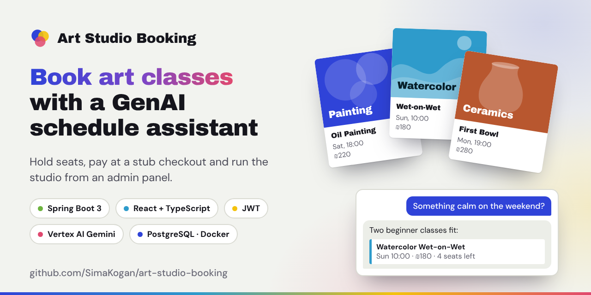
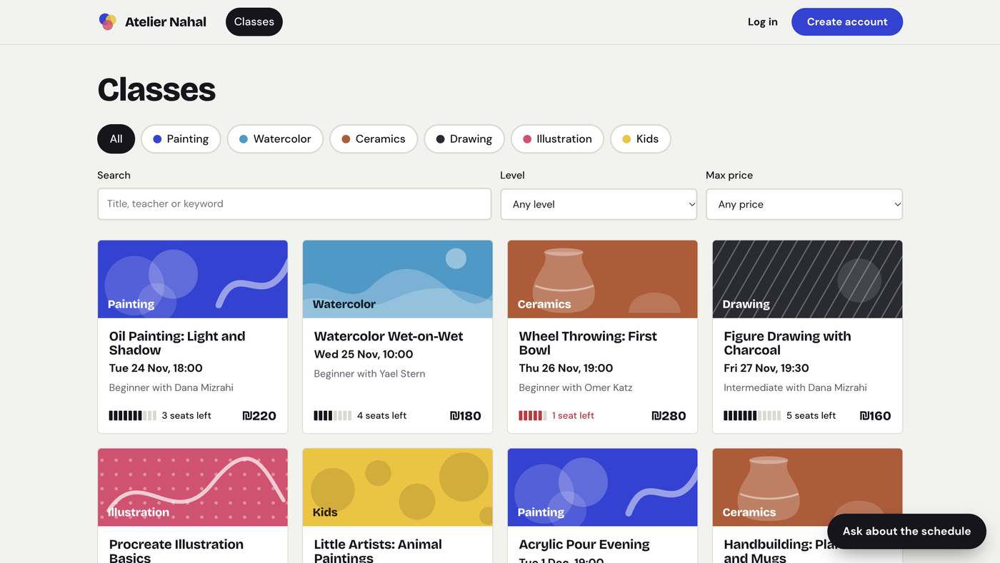
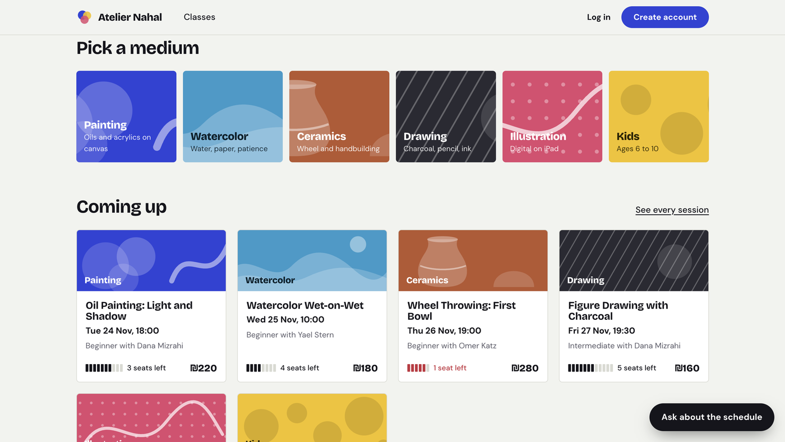
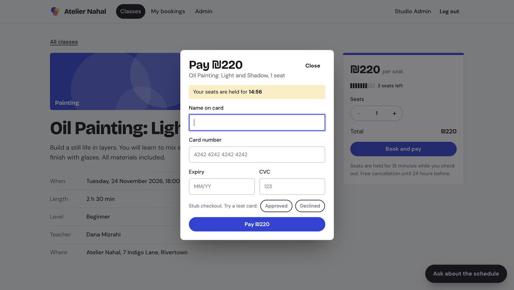
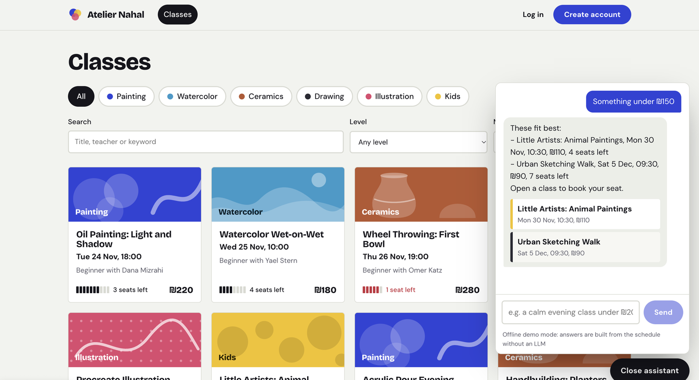
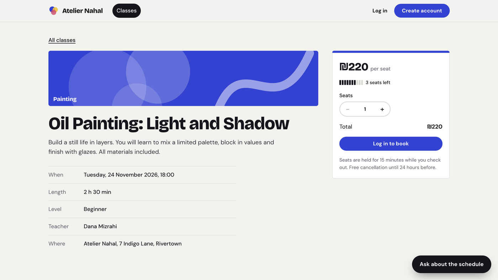
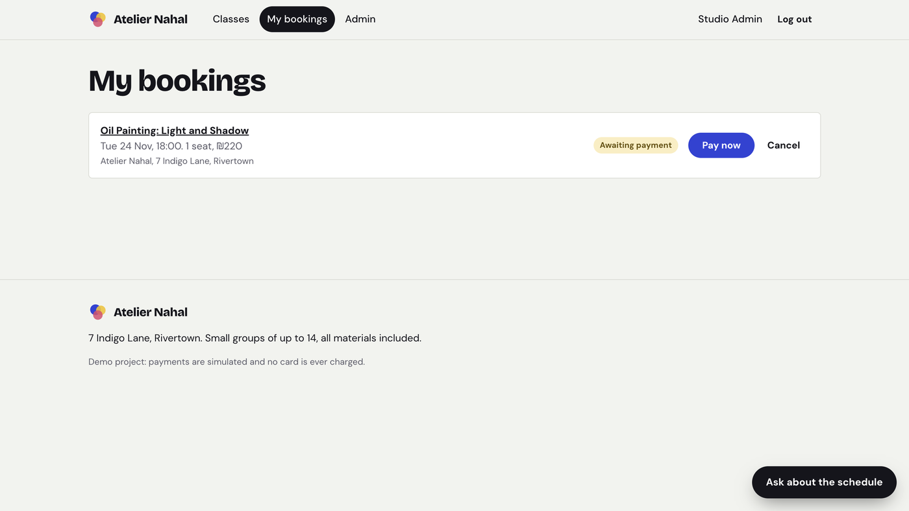
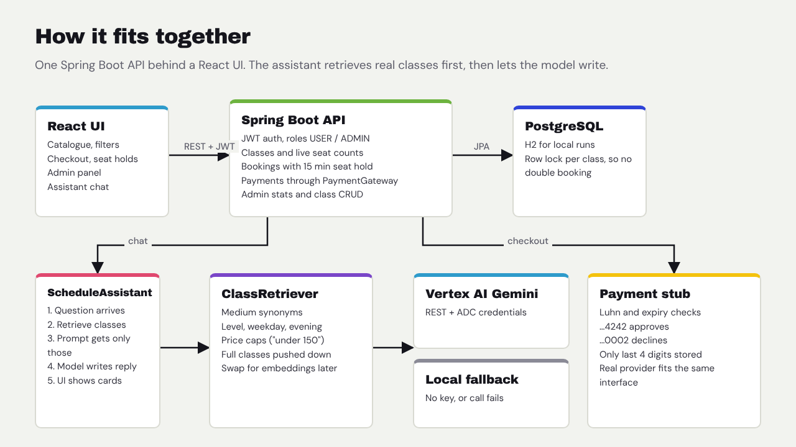

# Art Studio Booking

<p align="center"></p>

Full-stack booking platform for a small art studio: browse classes, hold seats, pay (simulated), manage the schedule in an admin panel, and ask a GenAI assistant what to book.

**Stack:** Java 17 · Spring Boot 3.3 · Spring Security (JWT) · JPA · H2 / PostgreSQL · React 18 · TypeScript · Vite · Vertex AI (Gemini)

*Русская версия: [README.ru.md](README.ru.md)*

## What it does

| Area | Details |
|---|---|
| Catalogue | Upcoming classes in six media, filters by medium, level, price and keyword, live seat availability |
| Booking | Seats are **held for 15 minutes** while you check out, capacity is enforced under a database row lock, no double booking, free cancellation up to 24 hours before |
| Payments (stub) | `PaymentGateway` interface with a mock implementation: Luhn check, expiry check, approved and declined test cards, only the last four digits stored, refunds on cancellation |
| Accounts | Register / log in, stateless JWT (HS256), roles `USER` and `ADMIN` |
| Admin panel | KPIs, seat fill and revenue per medium, class CRUD (hide instead of delete), all bookings with cancel and refund |
| GenAI assistant | Chat that answers from the real schedule: retrieval over upcoming classes, then Gemini on Vertex AI writes the answer; works offline without a key |

## Screenshots

<table align="center">
  <tr>
    <td width="50%"></td>
    <td width="50%"></td>
  </tr>
  <tr>
    <td width="50%"></td>
    <td width="50%"></td>
  </tr>
  <tr>
    <td width="50%"></td>
    <td width="50%"></td>
  </tr>
</table>

## Quick start

Requirements: JDK 17, Maven 3.9+, Node 20+.

```bash
# 1. backend (H2 in memory, demo data seeded) -> http://localhost:8080
cd backend && mvn spring-boot:run

# 2. frontend -> http://localhost:5173 (proxies /api to :8080)
cd frontend && npm install && npm run dev
```

Or everything with PostgreSQL in containers:

```bash
cp .env.example .env     # set DB_PASSWORD and JWT_SECRET
docker compose up --build   # app on http://localhost:8081, API docs on http://localhost:8080/swagger-ui.html
```

### Demo accounts

| Role | Email | Password |
|---|---|---|
| Admin | `admin@atelier.local` | `Admin123!` |
| Student | `demo@atelier.local` | `Demo12345!` |

The demo studio ("Atelier Nahal"), its teachers and students are fictional. Disable seeding with `SEED_DEMO_DATA=false`.

### Payment test cards

| Card number | Result |
|---|---|
| `4242 4242 4242 4242` | Approved |
| `4000 0000 0000 0002` | Declined |
| any number failing the Luhn check | Declined, "Card number is not valid" |

Use any future expiry (for example `12/40`) and any 3-digit CVC. Nothing leaves the process.

## Architecture

<p align="center"></p>

### Booking lifecycle

`PENDING` (seats held 15 min) → `CONFIRMED` (payment approved) → `CANCELLED`. Unpaid holds become `EXPIRED` and release their seats (a scheduled job plus a check on every new booking). A declined card keeps the hold alive so the user can retry.

Capacity is checked after `SELECT ... FOR UPDATE` on the class row, so two people cannot take the last seat at the same time.

### GenAI schedule assistant

`POST /api/assistant/chat`

1. **Retrieve.** `ClassRetriever` scores upcoming classes against the question: medium synonyms, level, weekdays, today / tomorrow / weekend, morning / evening and price caps ("under 150"). Full classes are pushed down.
2. **Ground.** Only the top four classes go into the prompt. The system prompt forbids inventing classes, prices or dates and tells the model to ignore instructions inside the user message.
3. **Generate.** `VertexGeminiClient` calls Gemini through the Vertex AI REST API with Application Default Credentials.
4. **Show.** The UI renders the same classes as links, so every suggestion is bookable and comes from the database, not from the model.

If Vertex AI is not configured or the call fails, `LocalLlmClient` writes the answer from the retrieved classes with a template, so the chat never breaks (and CI needs no key).

The retrieval is lexical on purpose, to stay dependency-free. For a large catalogue, replace `ClassRetriever` with embeddings (Vertex AI `text-embedding` + pgvector) behind the same method.

To use Gemini:

```bash
gcloud auth application-default login
export AI_PROVIDER=vertex VERTEX_PROJECT_ID=<your-project> VERTEX_LOCATION=us-central1
# optional: VERTEX_MODEL=gemini-2.5-flash
mvn -f backend spring-boot:run
```

## API

Interactive docs: `/swagger-ui.html`.

| Method | Path | Access |
|---|---|---|
| POST | `/api/auth/register`, `/api/auth/login` | public |
| GET | `/api/auth/me` | user |
| GET | `/api/classes?category=&level=&q=&maxPrice=` | public |
| GET | `/api/classes/{id}` | public |
| POST | `/api/bookings` | user |
| GET | `/api/bookings/my` | user |
| DELETE | `/api/bookings/{id}` | owner |
| POST | `/api/payments/checkout` | user (stub) |
| POST | `/api/assistant/chat` | public |
| GET | `/api/admin/stats`, `/api/admin/classes`, `/api/admin/bookings` | admin |
| POST / PUT / DELETE | `/api/admin/classes[/{id}]` | admin |
| DELETE | `/api/admin/bookings/{id}` | admin |

Errors are RFC 7807 problem documents (`{"status":409,"detail":"This class is full"}`).

## Configuration

| Variable | Default | Purpose |
|---|---|---|
| `DB_URL`, `DB_USER`, `DB_PASSWORD` | in-memory H2 | Database. Compose sets PostgreSQL |
| `JWT_SECRET` | dev value | HS256 key, at least 32 bytes. **Set it in production** |
| `CORS_ORIGINS` | `http://localhost:5173` | Comma-separated allowed origins |
| `SEED_DEMO_DATA` | `true` | Seed demo classes and accounts on an empty database |
| `AI_PROVIDER` | `local` | `local` or `vertex` |
| `VERTEX_PROJECT_ID`, `VERTEX_LOCATION`, `VERTEX_MODEL` | | Vertex AI settings |

## Project layout

```
backend/   Spring Boot (domain, repo, service, ai, web, seed) + tests
frontend/  React + TypeScript + Vite (pages, components, one CSS file)
docker-compose.yml   PostgreSQL + API + nginx-served UI
.github/workflows/   CI: mvn verify, npm run build
```

## Tests

```bash
cd backend && mvn test
```

Unit tests cover the payment stub and the retriever. An integration test drives the whole flow through HTTP: login, hold seats, declined then approved payment, duplicate booking, overbooking, admin-only access, assistant suggestions and validation errors.

## Design

The UI uses a pigment palette on a primed-canvas ground: each medium has its own colour (ultramarine, cerulean, sienna, graphite, rose madder, cadmium yellow) that follows a class from the filters to the cards to the admin charts. Type is Bricolage Grotesque with DM Sans. No stock photos: covers are generated SVG.

## Roadmap

- Real payment provider behind `PaymentGateway` (Stripe, Tranzila) with webhooks
- Email confirmations and calendar (.ics) export
- Embedding-based retrieval for the assistant
- Waiting list for full classes
- Rate limiting on the public assistant endpoint

## License

MIT, see [LICENSE](LICENSE).
