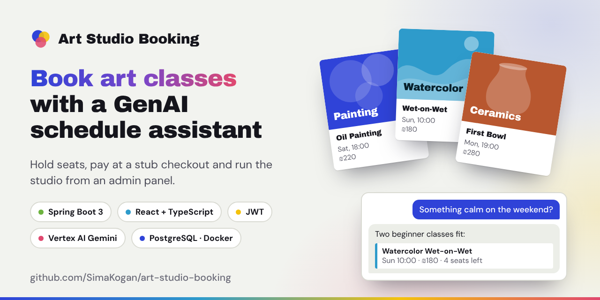
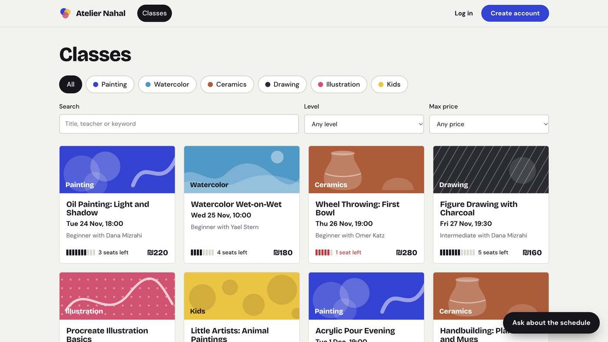
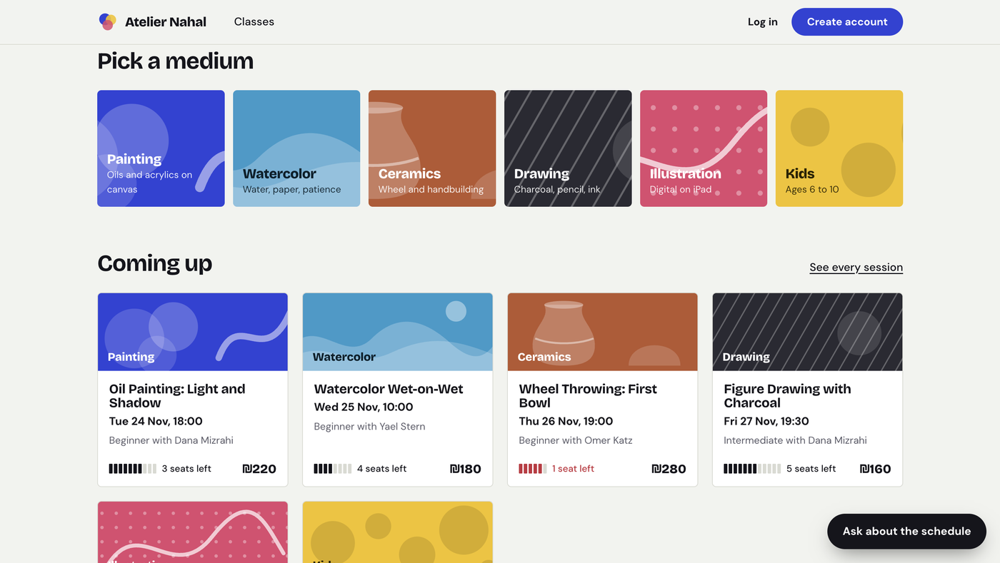
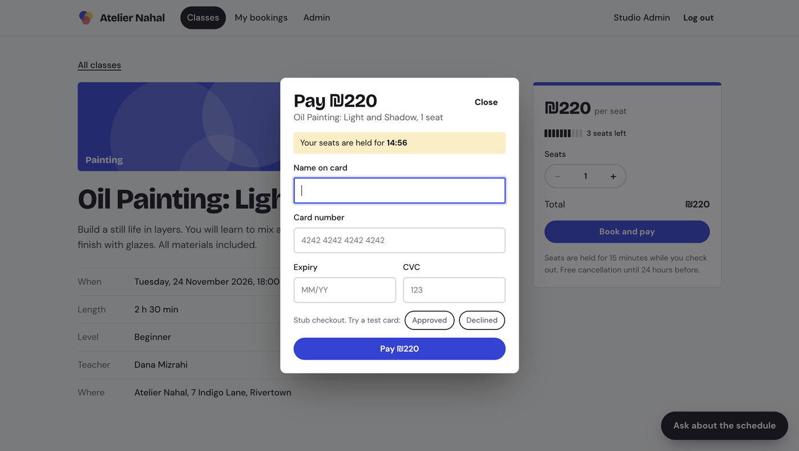
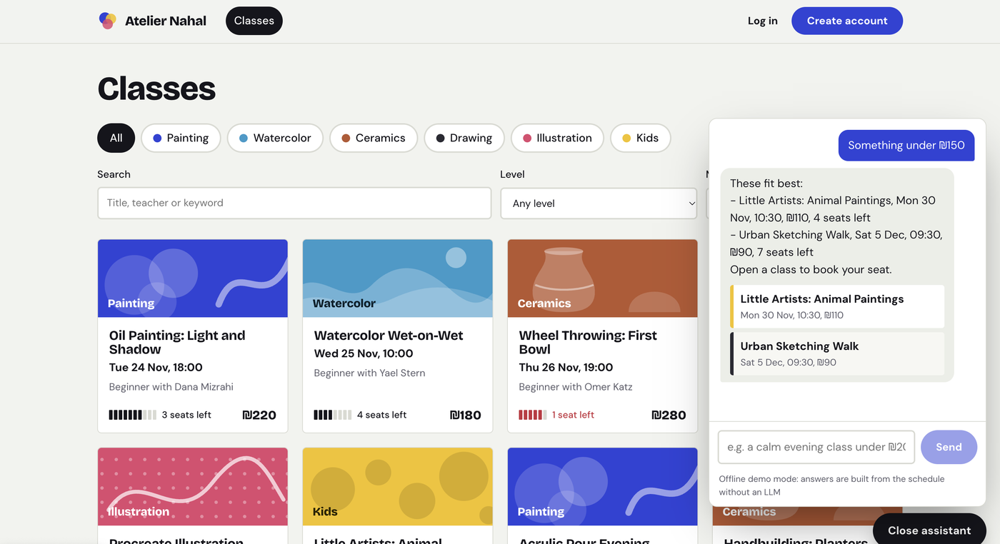
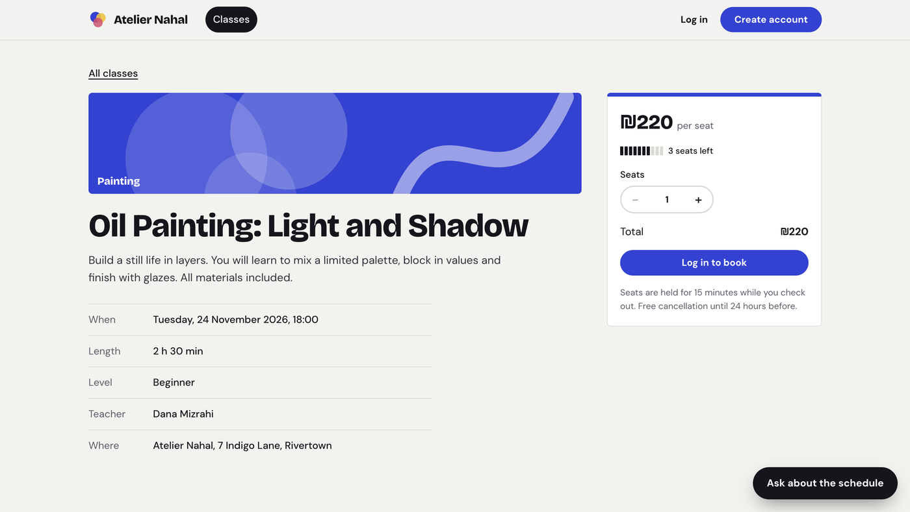
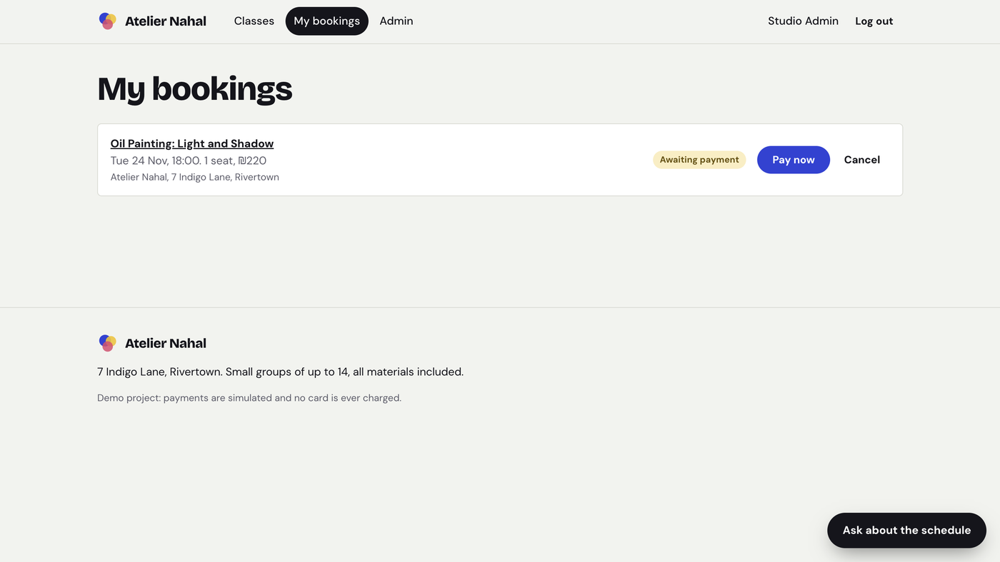

# Art Studio Booking

<p align="center"></p>

Полноценная система записи для небольшой арт-студии: каталог занятий, бронирование мест, оплата (заглушка), админ-панель и GenAI-помощник, который подсказывает, на что записаться.

**Стек:** Java 17 · Spring Boot 3.3 · Spring Security (JWT) · JPA · H2 / PostgreSQL · React 18 · TypeScript · Vite · Vertex AI (Gemini)

*English version: [README.md](README.md)*

## Возможности

- **Каталог.** Фильтры по направлению, уровню, цене и ключевому слову, актуальное число свободных мест.
- **Бронирование.** Места удерживаются 15 минут на время оплаты, вместимость проверяется под блокировкой строки в БД, двойная запись невозможна, бесплатная отмена за 24 часа до занятия.
- **Оплата-заглушка.** Интерфейс `PaymentGateway` с mock-реализацией: проверка Luhn и срока карты, тестовые карты для успеха и отказа, хранятся только последние 4 цифры, возврат при отмене.
- **Аккаунты.** Регистрация и вход, JWT (HS256), роли `USER` и `ADMIN`.
- **Админ-панель.** Показатели, заполняемость и выручка по направлениям, CRUD занятий, все записи с отменой и возвратом.
- **GenAI-помощник.** Отвечает по реальному расписанию: сначала поиск подходящих занятий, затем Gemini на Vertex AI формулирует ответ. Без ключа работает офлайн.

## Скриншоты

<table align="center">
  <tr>
    <td width="50%"></td>
    <td width="50%"></td>
  </tr>
  <tr>
    <td width="50%"></td>
    <td width="50%"></td>
  </tr>
  <tr>
    <td width="50%"></td>
    <td width="50%"></td>
  </tr>
</table>

## Запуск

Нужны JDK 17, Maven 3.9+, Node 20+.

```bash
# бэкенд (H2 в памяти, демо-данные) -> http://localhost:8080
cd backend && mvn spring-boot:run

# фронтенд -> http://localhost:5173
cd frontend && npm install && npm run dev
```

Всё сразу с PostgreSQL в контейнерах:

```bash
cp .env.example .env      # задайте DB_PASSWORD и JWT_SECRET
docker compose up --build    # приложение: http://localhost:8081
```

**Демо-аккаунты:** `admin@atelier.local` / `Admin123!` (админ) и `demo@atelier.local` / `Demo12345!` (студент). Студия «Atelier Nahal» и все её данные вымышленные.

**Тестовые карты:** `4242 4242 4242 4242` проходит, `4000 0000 0000 0002` отклоняется. Срок любой в будущем (например `12/40`), CVC любые 3 цифры.

## GenAI-помощник

`POST /api/assistant/chat`: `ClassRetriever` выбирает до четырёх подходящих занятий (направление, уровень, день недели, утро/вечер, ограничение по цене), только они попадают в промпт, `VertexGeminiClient` пишет ответ, а интерфейс показывает те же занятия карточками со ссылками на запись. Если Vertex AI не настроен или недоступен, отвечает `LocalLlmClient`, поэтому чат не ломается и тестам не нужен ключ.

Включить Gemini:

```bash
gcloud auth application-default login
export AI_PROVIDER=vertex VERTEX_PROJECT_ID=<ваш-проект> VERTEX_LOCATION=us-central1
mvn -f backend spring-boot:run
```

Поиск намеренно лексический, без внешних зависимостей. Для большого каталога его можно заменить на эмбеддинги (Vertex AI `text-embedding` + pgvector).

## Тесты

```bash
cd backend && mvn test
```

Юнит-тесты платёжной заглушки и поиска, плюс интеграционный тест полного сценария: вход, удержание мест, отказ и успешная оплата, повторная запись, перебронирование, доступ только для админа, подсказки помощника.

## Структура

```
backend/   Spring Boot (domain, repo, service, ai, web, seed) + тесты
frontend/  React + TypeScript + Vite
docker-compose.yml   PostgreSQL + API + UI на nginx
.github/workflows/   CI: mvn verify и npm run build
```

Подробности по API, конфигурации и архитектуре: [README.md](README.md).
